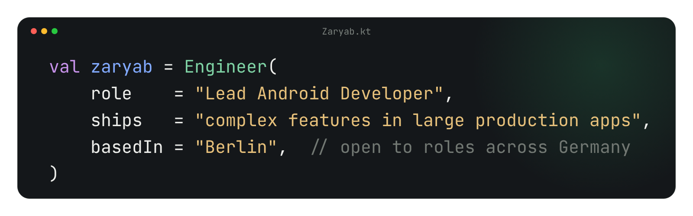

  

  
  
  
  

Hi, I'm **Zaryab** — a hands-on Lead Android Developer in Berlin. 8+ years building Android apps across messaging, banking, social and crypto; since 2023 I've led Android and iOS squads while still writing production Kotlin.

**Open to Lead and Senior Android roles in Germany** — on-site or remote, available now.

### What I've shipped

- **10M+ downloads** — led the Android & iOS squad that launched **Comera Pay**: Google Pay, government payments and national digital-identity sign-in.
- **1M+ downloads** — split **Abu Dhabi Islamic Bank's** monolithic app into owned modules, without pausing feature delivery.
- **~30% faster builds** — Gradle profiling that fixed several bottlenecks, not just one.
- **90–95% test coverage** on refactored features — and an engineer mentored through to promotion.
- **Hardened against attack** — owned app shielding with the vendor: obfuscation, root and Frida detection.
- **Legacy → Kotlin** — migrated a Bitcoin wallet from Java to Kotlin piece by piece, with JNI/NDK crypto bindings.

Download figures are Google Play download counts.

### Career

`2025 – 26` &nbsp;**Lead Android Developer** · Comera\
`2023 – 25` &nbsp;**Lead Android Developer** · Abu Dhabi Islamic Bank\
`2021 – 23` &nbsp;**Senior Android Developer** · Abu Dhabi Islamic Bank\
`2018 – 21` &nbsp;**Android → Senior Android Developer** · Ilsa Interactive

### Stack

  
  
  
  
  
  
  
  
  

### Kind words

> He approaches challenges with an analytical mindset, successfully overcoming obstacles, as demonstrated during a complex payment integration when we worked together.
>
> — **Syed Adil**, Senior Digital Product Owner, managed me directly · [more on LinkedIn](https://www.linkedin.com/in/iamzaryab/details/recommendations/)

---

<b>Hiring for Android?</b> <a href="mailto:zaryabshakir96@gmail.com?subject=Android%20role">Let's talk</a> · full story at <a href="https://zaryab.work">zaryab.work</a> · selected repositories pinned below ↓

