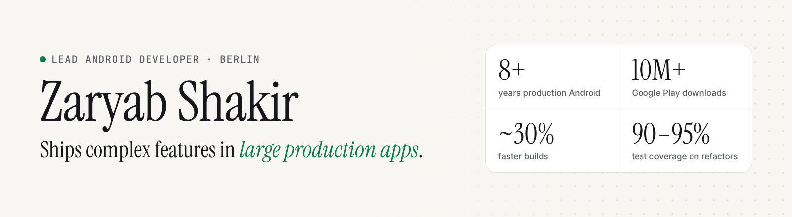

<picture>
  <source media="(prefers-color-scheme: dark)" srcset="assets/cover-dark.png">
  
</picture>

  <a href="https://zaryab.work"><b>Portfolio</b></a> ·
  <a href="https://www.linkedin.com/in/iamzaryab">LinkedIn</a> ·
  <a href="mailto:zaryabshakir96@gmail.com">Email</a> ·
  <a href="https://zaryab.work/Zaryab_Shakir_CV_Lead_Android_Developer.pdf">CV (PDF)</a>

Hi, I'm **Zaryab** — a hands-on **Lead Android Developer** in Berlin. For 8+ years I've built Android apps across messaging, banking, social and crypto, and since 2023 I've led Android and iOS squads while still writing production Kotlin every week.

**Open to Lead and Senior Android roles in Germany** — on-site anywhere in Germany, or remote. Available immediately.

## Impact

| Result | How |
|---|---|
| **Shipped a new product inside a 10M+ download app** | Led the four-engineer Android & iOS squad that launched Comera Pay: Google Pay end-to-end, a government-payments integration on fixed external deadlines, and national digital-identity sign-in. |
| **Broke up a monolith without pausing delivery** | At Abu Dhabi Islamic Bank (1M+ downloads), split a monolithic codebase into modules with clear ownership — chosen over a rewrite so features kept shipping. |
| **Made the team faster and safer** | ~30% faster builds through Gradle profiling, 90–95% unit-test coverage on refactored features, and an engineer mentored through to promotion. |
| **Hardened an app against attack** | Owned app shielding with the vendor: obfuscation, root and Frida detection, release sign-off. |
| **Migrated legacy code without a rewrite** | Moved a Bitcoin wallet from legacy Java to Kotlin piece by piece, with JNI/NDK bindings over proven C/C++ crypto libraries. |

Download figures are Google Play download counts, not active users.

## Experience

- **Lead Android Developer** · Comera · 2025 – 2026
- **Lead Android Developer** · Abu Dhabi Islamic Bank · 2023 – 2025 (promoted from Senior)
- **Senior Android Developer** · Abu Dhabi Islamic Bank · 2021 – 2023
- **Android → Senior Android Developer** · Ilsa Interactive · 2018 – 2021

## Open source

| Project | What it shows |
|---|---|
| [**FilmKu**](https://github.com/Iamzaryab/Flutter-Movie-App-with-Clean-Architecture-and-RiverPod-State-Management) · ⭐ 100+ | Flutter on Clean Architecture with Riverpod and an Isar offline cache |
| [**Movie App — Jetpack Compose**](https://github.com/Iamzaryab/Movie-Application-Android-Jetpack-Compose) | Declarative UI with Jetpack Compose and Hilt |
| [**secp256k1 for Android**](https://github.com/Iamzaryab/Secp256K1-android) | Native elliptic-curve crypto: Java wrapper over the C library via JNI |
| [**BIP39 Mnemonic**](https://github.com/Iamzaryab/Bip39-Mnemonic-android) · fork | BIP39 mnemonic generation for Android wallets (Java) — pairs with secp256k1 for key derivation |
| [**ChatGPT Client (KMP)**](https://github.com/Iamzaryab/Chat-GPT-Application-KMM) | Kotlin Multiplatform experiment sharing domain and data layers across Android and iOS |
| [**Android Media Gallery**](https://github.com/Iamzaryab/Android-Media-Gallery) | Clean Architecture, MVI with StateFlow, Hilt, MediaStore, unit-tested repository layer |

## Toolbox

**Android:** Kotlin · Jetpack Compose · Coroutines & Flow · Room · WorkManager · Hilt\
**Architecture & quality:** Clean Architecture · MVI / MVVM · Modularisation · JUnit · Turbine · Espresso · Gradle performance · CI/CD\
**Security & integrations:** App shielding · Root & Frida detection · Certificate pinning · Google Pay · Digital identity · JNI / NDK\
**Also:** Java · C++ · Kotlin Multiplatform · Flutter

## What colleagues say

> He approaches challenges with an analytical mindset, successfully overcoming obstacles, as demonstrated during a complex payment integration when we worked together.
>
> — **Syed Adil**, Senior Digital Product Owner · managed me directly · [more on LinkedIn](https://www.linkedin.com/in/iamzaryab/details/recommendations/)

---

Hiring for Android? <a href="mailto:zaryabshakir96@gmail.com?subject=Android%20role"><b>Let's talk</b></a> — or see the full story at <a href="https://zaryab.work"><b>zaryab.work</b></a>.

