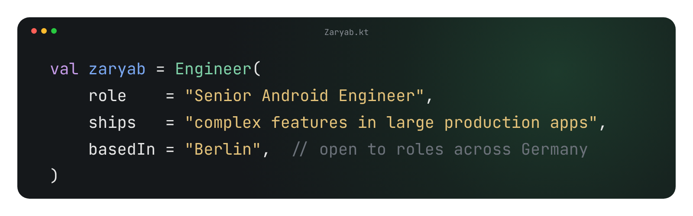

  

  
  
  
  

Hi, I'm **Zaryab**, a hands-on Senior Android Engineer in Berlin. 8+ years building Android apps across messaging, banking, payments, social and crypto. Since 2023 I've led Android and iOS squads while still writing production Kotlin every day, and I use AI-assisted development (Claude Code, GitHub Copilot, Codex) in my daily work.

**Open to Senior Android roles in Germany**, on-site or remote. Valid German residence permit, no sponsorship needed, available now.

### What I've shipped

- **10M+ downloads**: at **Comera Pay**, raised crash-free users from **93% to 98%** and ANR-free users from **90% to 99%**, and shipped Google Pay, Abu Dhabi government payments and UAE PASS digital-ID sign-in.
- **Secure login**: rebuilt secure token storage and exchange, ending forced logouts and payments stuck mid-flow.
- **1M+ downloads**: split **Abu Dhabi Islamic Bank's** legacy app into modules, cutting builds from **15–20 to 7–8 minutes** without pausing feature delivery.
- **Three teams, one feature**: drove secure second-device registration to production across mobile, identity and backend teams.
- **Hardened against attack**: owned app shielding with the security vendor (obfuscation, ProGuard/R8, root and Frida detection); every release passed penetration testing with no critical findings.
- **AI in the workflow**: built Claude skills my team adopted as internal tools; every AI change reviewed and tested.
- **Crypto R&D**: Kotlin and JNI/NDK bindings over C/C++ crypto libraries (secp256k1, BIP32, BIP39), and a Bitcoin wallet migrated from Java to Kotlin.

Download figures are Google Play download counts.

### Career

`2025 – 26` &nbsp;**Lead Android Developer** · Comera\
`2021 – 25` &nbsp;**Senior Android Developer** (squad lead from 2023) · Abu Dhabi Islamic Bank\
`2018 – 21` &nbsp;**Android Developer** · Ilsa Interactive, Lahore

### Stack

  
  
  
  
  
  
  
  
  
  
  

### Kind words

> He approaches challenges with an analytical mindset, successfully overcoming obstacles, as demonstrated during a complex payment integration when we worked together.
>
> — **Syed Adil**, Senior Digital Product Owner, managed me directly · [more on LinkedIn](https://www.linkedin.com/in/iamzaryab/details/recommendations/)

---

<b>Hiring for Android?</b> <a href="mailto:zaryabshakir96@gmail.com?subject=Android%20role">Let's talk</a> · full story at <a href="https://zaryab.work">zaryab.work</a> · selected repositories pinned below ↓

